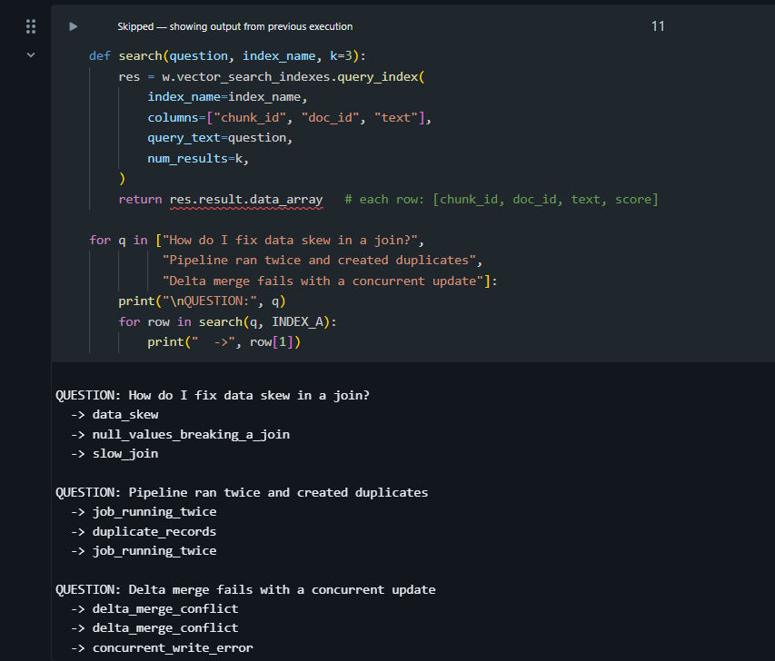
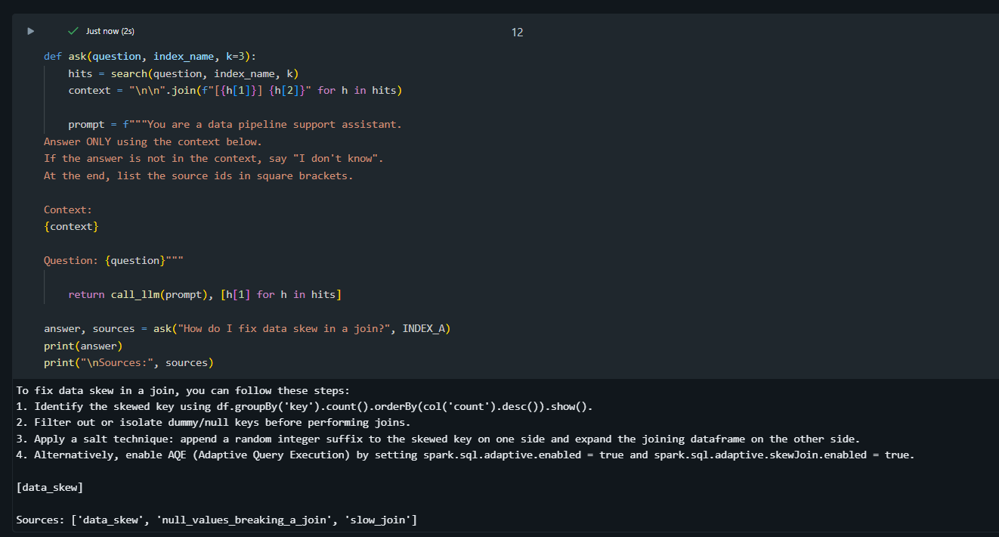
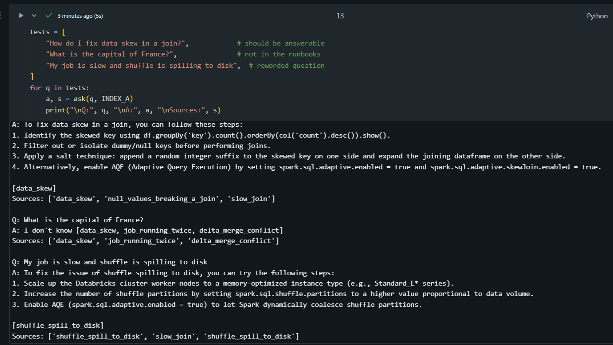
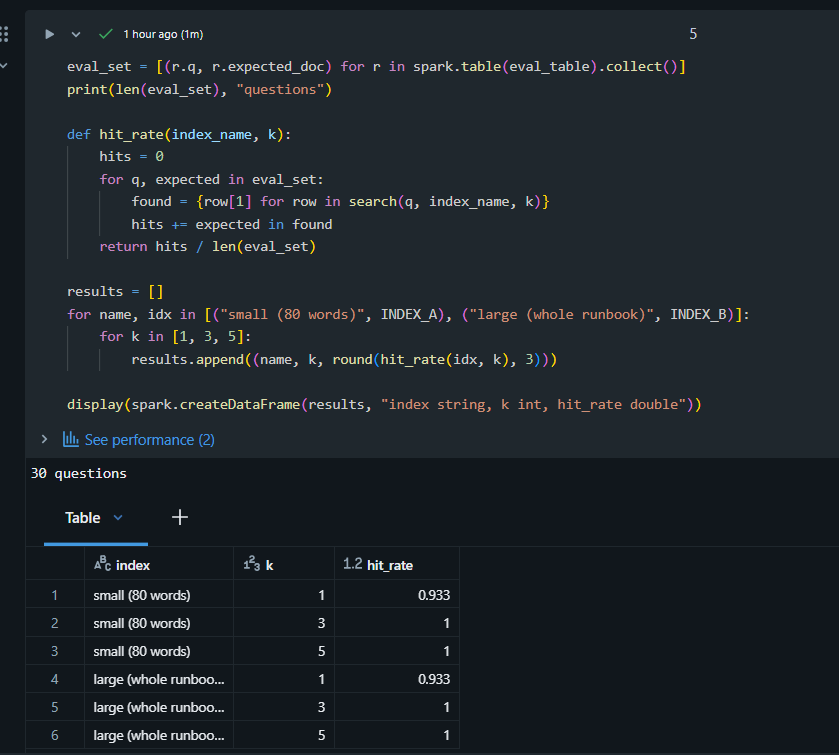
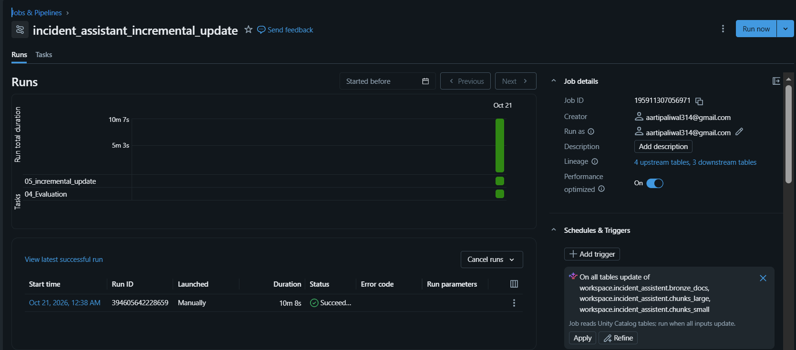

<div align="center">

# 🚨 Pipeline Incident Assistant

### Ask a question about a failed data pipeline. Get the fix, with its source.

A RAG (Retrieval-Augmented Generation) assistant built end to end on **Databricks Free Edition**: ingestion, chunking, vector search, grounded answers, evaluation, incremental updates and job orchestration.


</div>

---

## 📌 Quick links

[Problem](#-the-problem) · [Demo](#-see-it-in-action) · [Features](#-key-features) · [Architecture](#-architecture) · [Evaluation](#-evaluation-small-chunks-vs-large-chunks) · [Incremental updates](#-incremental-updates-no-full-rebuild) · [Orchestration](#-orchestration-with-databricks-jobs) · [Run it yourself](#-run-it-yourself)

---

## 🎯 The problem

When a data pipeline fails, engineers lose time digging through long runbooks to find the right fix. The answer is usually in there, buried in a large document.

## 💡 The solution

This assistant does the searching for you:

1. You ask a question in plain English.
2. It finds the most relevant parts of the runbooks using semantic search.
3. An LLM writes a short answer **using only those parts** and tells you which runbook it came from.
4. If the answer is not in the runbooks, it says **"I don't know"** instead of guessing.

---

## 🎬 See it in action

**Question:** *What should I do if a data skew incident is not resolved in time?*

**Answer:**

> You should contact the Platform Data team in the channel `platform-data-help` if a data skew incident is not resolved within two hours.
>
> `[source ids: [data_skew]]`

| 🔍 Search results | 🤖 RAG answer | 🙅 Out-of-scope question |
|:---:|:---:|:---:|
|  |  |  |

---

## ✨ Key features

| | Feature | What it means |
|---|---|---|
| 🔎 | **Semantic search** | Finds the right runbook by meaning, not just matching words |
| 🧠 | **Grounded answers** | The LLM answers only from retrieved runbook text |
| 🙅 | **Hallucination guardrail** | Out-of-scope questions get "I don't know" |
| 📎 | **Source citations** | Every answer lists the runbook it used |
| ⚖️ | **Chunking comparison** | Small vs. large chunks, tested on the same questions |
| 🔄 | **Incremental updates** | Only new, changed or deleted runbooks are reprocessed |
| ⏱️ | **Job orchestration** | The update and evaluation run as a Databricks Job |

---

## 🏗️ Architecture


**In simple words:**

1. Runbooks are loaded into a Delta table (`bronze_docs`).
2. They are cut into pieces called **chunks**, in two sizes.
3. Each chunk is turned into numbers (an **embedding**) and stored in a **Vector Search** index.
4. A question is embedded the same way and the closest chunks are retrieved.
5. Llama 3.3 70B reads those chunks and writes the answer with its sources.
6. An incremental update keeps everything in sync when runbooks change.

---

## 🧰 Tech stack

| Layer | Technology |
|---|---|
| Platform | Databricks Free Edition (serverless compute) |
| Storage | Unity Catalog Volume, Delta Lake |
| Processing | Python, PySpark |
| Embedding model | `databricks-gte-large-en` |
| Retrieval | Databricks Vector Search |
| LLM | `databricks-meta-llama-3-3-70b-instruct` |
| Access | Databricks SDK |
| Orchestration | Databricks Jobs |

---

## 📁 Project structure

```
incident-assistant/
├── data/
│   ├── docs_part1.json              # synthetic runbooks (part 1)
│   └── docs_part2.json              # synthetic runbooks (part 2)
├── notebooks/
│   ├── 01_setup_and_data.ipynb      # schema, volume, bronze table
│   ├── 02_chunk_and_index.ipynb     # small and large chunk tables
│   ├── 03_vector_search.ipynb       # endpoint, indexes, search(), ask()
│   ├── 04_Evaluation.ipynb          # small vs. large chunk comparison
│   └── 05_incremental_update.ipynb  # update only what changed
├── docs/                            # screenshots and architecture diagram
└── README.md
```

---

## 🔬 How it works

### 1. Data and chunking
About 30 synthetic incident runbooks (ADF failures, data skew, late upstream data and more) are loaded into the bronze table `bronze_docs`, then split two ways:

| Table | Chunks | Good for |
|---|:---:|---|
| `chunks_small` | 61 | Precise, focused matches |
| `chunks_large` | 30 | More context per match |

### 2. Vector Search
- Endpoint: `incident_vs_endpoint`
- Indexes: `idx_small` and `idx_large` (one per chunk table)
- Embeddings: `databricks-gte-large-en`

### 3. Retrieve and answer
- `search()` returns the top matching chunks.
- `ask()` sends the question and chunks to Llama 3.3 70B.
- The prompt tells the model to use **only** the given context and to say "I don't know" otherwise.
- The answer ends with the source runbook IDs.

---

## 📊 Evaluation: small chunks vs. large chunks

Chunk size is the biggest tuning choice in RAG, so I measured it instead of guessing. I wrote test questions with a known correct runbook for each, ran them against both indexes and checked whether the right runbook appeared in the top results.



| Index | Chunks | Questions tested | Correct runbook in top 3 |
|---|:---:|:---:|:---:|
| `idx_small` | 61 | [X] | [Y]% |
| `idx_large` | 30 | [X] | [Y]% |

**Takeaway:** [One line, for example: "Small chunks found the right runbook more often because each chunk covers a single topic."]

---

## 🔄 Incremental updates (no full rebuild)

Runbooks change. Re-chunking and re-embedding everything for each edit is slow and wasteful, so `05_incremental_update` only processes what changed:

1. Refresh the bronze table.
2. Detect **new, changed and deleted** runbooks.
3. Re-chunk **only** those runbooks in both chunk tables.
4. Sync both Vector Search indexes and wait until they are ready.

**How I tested it:** I edited the `data_skew` runbook and ran the update, then restored the original from a backup and ran it again. The assistant returned the correct original answer with the right source ID. A run with no changes adds 0 chunks, so the update is safe to repeat.


---

## ⏱️ Orchestration with Databricks Jobs

The pipeline runs as a Databricks Job, `incident_assistant_incremental_update`, with two tasks:

| Task | Purpose |
|---|---|
| `05_incremental_update` | Detect changes, re-chunk, sync both indexes |
| `04_Evaluation` | Quality check on retrieval after the update |

The Job runs on serverless compute and completed successfully (about 10 minutes for a full run).



> A time-based schedule can be added in the Job settings. I avoided a "table update" trigger because the Job writes to those same tables and could trigger itself.

---

## 🚀 Run it yourself

**You need:** a free [Databricks Free Edition](https://www.databricks.com/learn/free-edition) account.

1. **Clone this repo**
   ```bash
   git clone https://github.com/aartipaliwal/incident-assistant.git
   ```
2. **Import the notebooks** from `notebooks/` into your Databricks workspace.
3. **Upload the runbooks** from `data/` into a Databricks volume.
4. **Run the notebooks in order:** `01` → `02` → `03` → `04` → `05`.
5. **Ask a question:**
   ```python
   ask("What should I do if a data skew incident is not resolved in time?")
   ```
6. **Optional:** create a Job with tasks `05_incremental_update` and `04_Evaluation`.

> 💡 **Tip:** install the Vector Search library in the notebook where you use it, then restart Python. Installing it in a notebook that has other libraries loaded can crash the environment.

---

## 📚 What I learned

- Chunk size changes retrieval quality: small chunks are precise, large chunks keep context. Measure it.
- A strict prompt plus an "I don't know" rule is a simple, effective guardrail against hallucination.
- Incremental updates make a RAG pipeline practical for documents that keep changing.
- Evaluation works best when it is part of the pipeline, not an afterthought.

---

## 🔮 Future improvements

- Package with **Databricks Asset Bundles (DAB)** for repeatable deployment.
- Add hybrid search and reranking for better retrieval.
- Try parent-child retrieval: search small chunks, answer with the larger parent.
- Use a larger evaluation set and score the generated answers too.
- Add a chat interface using a Databricks App.

---

## 👩‍💻 Author

**Aarti Paliwal**: Associate Software Engineer | Azure Databricks | Data Engineering

[](https://github.com/aartipaliwal)
[](https://www.linkedin.com/in/aarti-paliwal)

⭐ If you found this useful, consider giving the repo a star!
