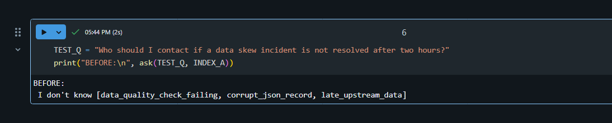

<div align="center">

# 🚨 Pipeline Incident Assistant

### Ask a question about a failed data pipeline. Get the fix, with the source.

A RAG (Retrieval-Augmented Generation) assistant built end to end on **Databricks Free Edition**.


</div>

---

## 💡 What is this project?

When a data pipeline fails, engineers waste time digging through long runbooks to find the fix.

This assistant does that search for you. You ask a question in plain English, it finds the right part of the right runbook, and an LLM writes a short answer **based only on those runbooks**.

If the answer is not in the runbooks, it says **"I don't know"** instead of making something up.

---

## 🎬 See it in action

**Question:** *What should I do if a data skew incident is not resolved in time?*

**Answer:**

> You should contact the Platform Data team in the channel `platform-data-help` if a data skew incident is not resolved within two hours.
>
> `[source ids: [data_skew]]`

Every answer shows which runbook it came from, so you can trust it and verify it.

| 🔍 Search results | 🤖 RAG answer | 🙅 Out-of-scope question |
|:---:|:---:|:---:|
|  |  |  |

---

## ✨ Key features

- 🔎 **Semantic search:** finds the right runbook by meaning, not just keywords.
- 🧠 **Grounded answers:** the LLM only answers from retrieved runbook text.
- 🙅 **Hallucination guardrail:** out-of-scope questions get "I don't know".
- 📎 **Source citations:** every answer lists the runbook it used.
- ⚖️ **Chunking comparison:** small chunks vs. large chunks, tested and measured.
- 🔄 **Incremental updates:** edit, add or delete a runbook and only that part is re-processed. No full rebuild.

---

## 🏗️ Architecture


**In simple words:**

1. Runbooks are loaded into a Delta table (`bronze_docs`).
2. They are cut into pieces called **chunks**, in two sizes (small and large).
3. Each chunk is converted into numbers (an **embedding**) and stored in a **Vector Search** index.
4. When you ask a question, the most similar chunks are retrieved.
5. Llama 3.3 70B reads those chunks and writes the answer.

---

## 🧰 Tech stack

| What | Tool |
|---|---|
| Platform | Databricks Free Edition |
| Storage | Unity Catalog Volume, Delta Lake |
| Processing | Python, PySpark |
| Embedding model | `databricks-gte-large-en` |
| Retrieval | Databricks Vector Search |
| LLM | `databricks-meta-llama-3-3-70b-instruct` |
| Access | Databricks SDK |

---

## 📁 Project structure

```
incident-assistant/
├── data/
│   ├── docs_part1.json            # synthetic runbooks (part 1)
│   └── docs_part2.json            # synthetic runbooks (part 2)
├── notebooks/
│   ├── 01_setup_and_data.ipynb    # schema, volume, bronze table
│   ├── 02_chunk_and_index.ipynb   # small and large chunk tables
│   ├── 03_vector_search.ipynb     # endpoint, indexes, search(), ask()
│   ├── 04_Evaluation.ipynb        # small vs. large chunk comparison
│   └── 05_incremental_update.ipynb # update only what changed
├── docs/                          # screenshots and architecture diagram
└── README.md
```

---

## 🔬 How it works

### 1. Data and chunking
About 30 synthetic incident runbooks (ADF failures, data skew, late upstream data and more) are loaded into the bronze table `bronze_docs`, then split two ways:

| Table | Chunks | Good for |
|---|:---:|---|
| `chunks_small` | 61 | Precise, focused matches |
| `chunks_large` | 30 | More context per match |

### 2. Vector Search
- Endpoint: `incident_vs_endpoint`
- Indexes: `idx_small` and `idx_large` (one per chunk table)
- Embeddings: `databricks-gte-large-en`

### 3. Retrieve and answer
- `search()` returns the top matching chunks.
- `ask()` sends the question and chunks to Llama 3.3 70B.
- The prompt tells the model to use **only** the given context, and to say "I don't know" otherwise.

---

## 📊 Evaluation: small chunks vs. large chunks

I wrote test questions with a known correct runbook for each, then checked whether the right runbook showed up in the top results.


| Index | Chunks | Questions tested | Correct runbook in top 3 |
|---|:---:|:---:|:---:|
| `idx_small` | 61 | [X] | [Y]% |
| `idx_large` | 30 | [X] | [Y]% |

**Takeaway:** [Write one line here, for example: "Small chunks retrieved the right runbook more often because each chunk covers one topic."]

---

## 🔄 Incremental updates (no full rebuild)

Runbooks change. Rebuilding everything each time is slow and wasteful, so `05_incremental_update` handles changes smartly:

1. Refresh the bronze table.
2. Detect **new, changed and deleted** runbooks.
3. Re-chunk **only** those runbooks.
4. Sync both Vector Search indexes and wait until they are ready.

**How I tested it:** I edited the `data_skew` runbook, ran the update, then restored the original from a backup and ran it again. The assistant returned the correct original answer with the right source ID, and a run with no changes added 0 chunks.

| Before the update | After restoring |
|:---:|:---:|
|  | *(add an "after" screenshot here)* |

---

## 🚀 Run it yourself

**You need:** a free [Databricks Free Edition](https://www.databricks.com/learn/free-edition) account.

1. **Clone this repo**
   ```bash
   git clone https://github.com/aartipaliwal/incident-assistant.git
   ```
2. **Import the notebooks** from `notebooks/` into your Databricks workspace.
3. **Upload the runbooks** from `data/` into a Databricks volume.
4. **Run the notebooks in order:** `01` → `02` → `03` → `04` → `05`.
5. **Ask a question:**
   ```python
   ask("What should I do if a data skew incident is not resolved in time?")
   ```

> ⚠️ **Heads up:** the schema is spelled `workspace.incident_assistent` (a typo I kept in the code). Use the same spelling in your queries, or rename it everywhere.
>
> 💡 **Tip:** install the Vector Search library in the notebook where you use it, then restart Python. Installing it in a notebook that has other libraries loaded can crash the environment.

---

## 📚 What I learned

- Chunk size changes retrieval quality: small chunks are precise, large chunks keep context.
- A strict prompt plus an "I don't know" rule is a simple, effective guardrail against hallucination.
- Incremental updates save time and make a RAG pipeline realistic for changing documents.

---

## 🔮 Future improvements

- Package with **Databricks Asset Bundles (DAB)** for repeatable deployment.
- Add a chat interface using a Databricks App.
- Add reranking and metadata filters.
- Use a larger test set for evaluation.
- Ingest real incident logs along with runbooks.

---

## 👩‍💻 Author

**Aarti Paliwal**: Associate Software Engineer | Azure Databricks | Data Engineering

[](https://github.com/aartipaliwal)
[](https://www.linkedin.com/in/YOUR-HANDLE)

⭐ If you found this useful, consider giving the repo a star!
