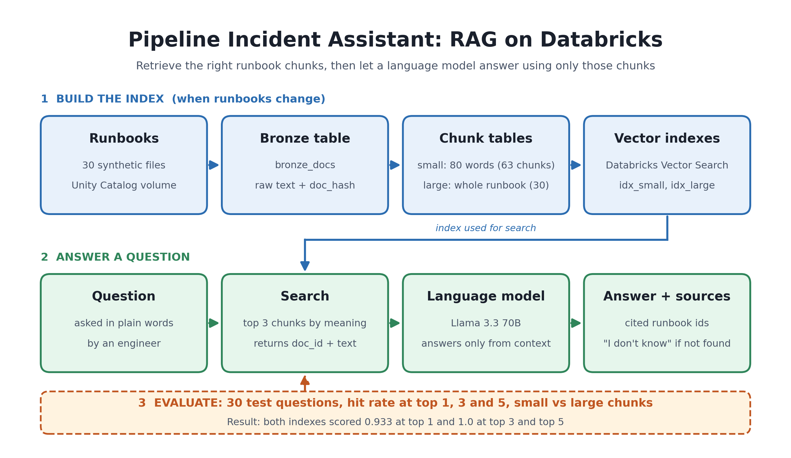

# 🚨 Enterprise Pipeline Incident Assistant (RAG on Databricks)

An end-to-end Retrieval-Augmented Generation (RAG) assistant designed to diagnose enterprise data pipeline incidents, parse operational runbooks, and provide grounded troubleshooting steps using Databricks, Vector Search, and Llama 3.3 70B.



---

## 📌 Project Overview

Data engineers and support teams often spend critical minutes during pipeline failures searching through scattered runbooks to identify root causes and remediation steps. 

This project delivers a production-ready RAG assistant built on **Databricks Free Edition**. It ingests raw incident runbooks into Delta Lake, evaluates dual-chunking strategies for vector indexing, retrieves semantically relevant context via **Databricks Vector Search**, and generates precise resolution steps using **Llama 3.3 70B Instruct**.

### 🌟 Key Highlights
* **Dual-Chunking Strategy**: Evaluated small (63 chunks) vs. large (30 chunks) text splitting to balance retrieval precision against context preservation.
* **Databricks Vector Search Integration**: Programmatically created and updated vector search endpoints and managed delta sync indexes using the Databricks SDK.
* **Incremental Synchronization**: Built automated pipelines to ingest new/modified runbooks into bronze tables and trigger vector index refreshes (`sync_and_wait`).
* **Strict Guardrails**: Fine-tuned prompt logic to enforce deterministic fallback responses (*"I don't know"*) for out-of-scope or ungrounded queries, eliminating hallucinations.

---

## 🏗️ System Architecture

```text
+---------------------+
| Raw Runbooks (JSON) |
+----------+----------+
           |
           v
+-------------------------------------------------------+
| Ingestion Layer (PySpark & Delta Lake)               |
| Schema: workspace.incident_assistent                  |
| Table: bronze_docs                                    |
+----------+--------------------------------------------+
           |
           +--------------------------+
           |                          |
           v                          v
+---------------------+    +---------------------+
| Small Chunks (63)   |    | Large Chunks (30)   |
| chunks_small        |    | chunks_large        |
+----------+----------+    +----------+----------+
           |                          |
           +--------------------------+
           |
           v
+-------------------------------------------------------+
| Databricks Vector Search (databricks-gte-large-en)    |
| Endpoint: incident_vs_endpoint                        |
| Indexes: idx_small, idx_large                         |
+----------+--------------------------------------------+
           |
           v
+-------------------------------------------------------+
| LLM Generation & Guardrails                           |
| Model: databricks-meta-llama-3-3-70b-instruct        |
| Logic: search() -> context retrieval -> ask()         |
+-------------------------------------------------------+
